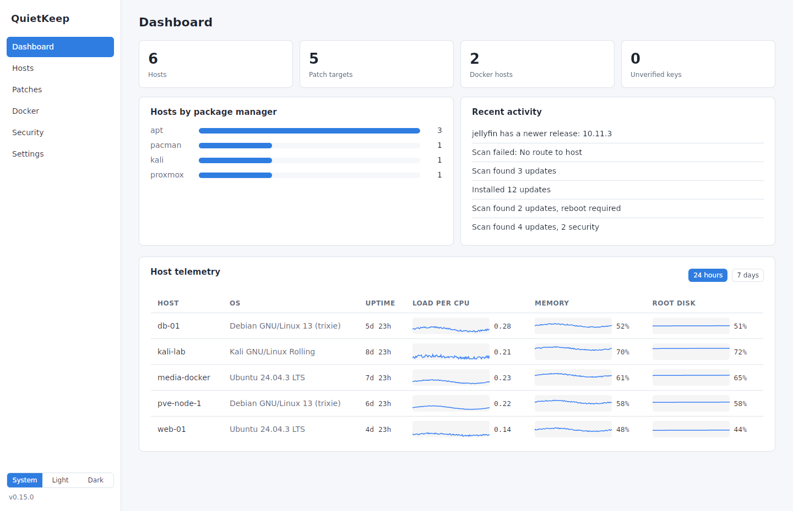
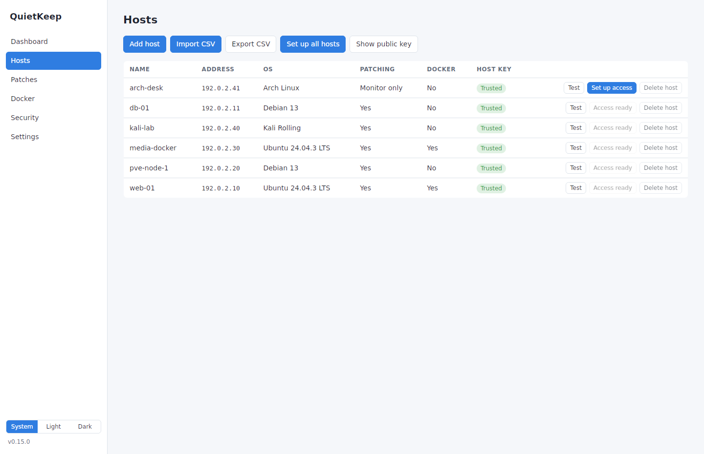
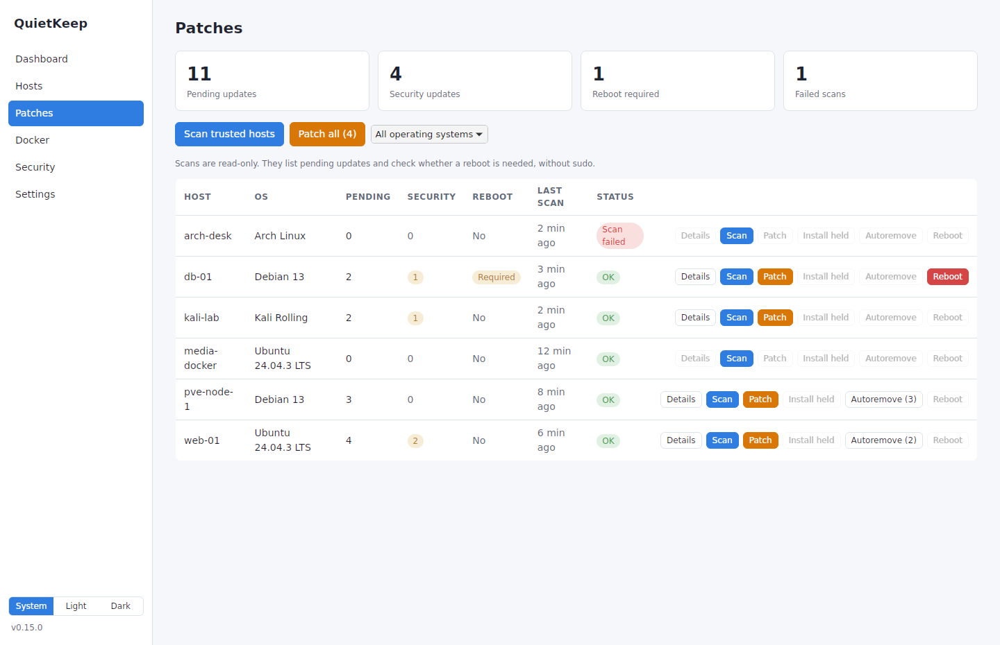
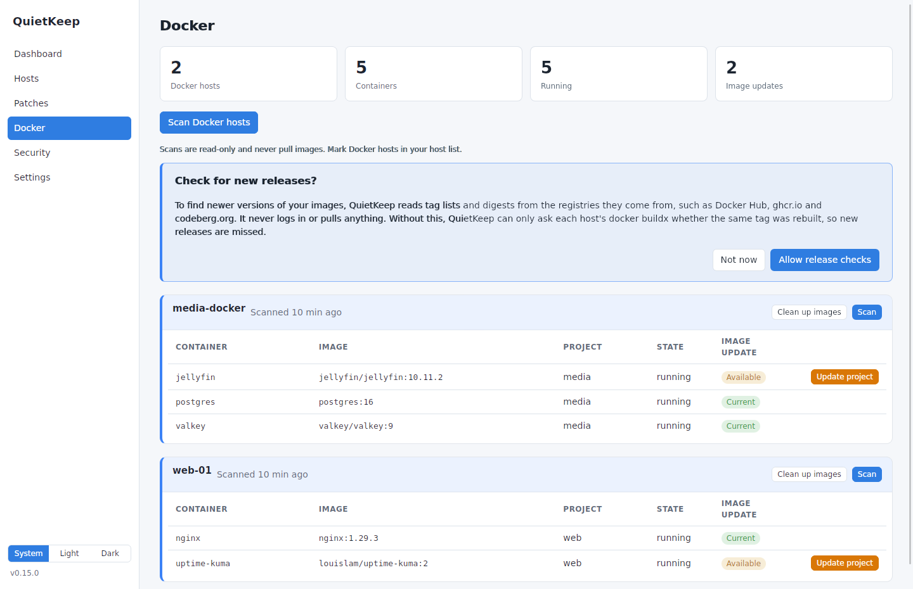
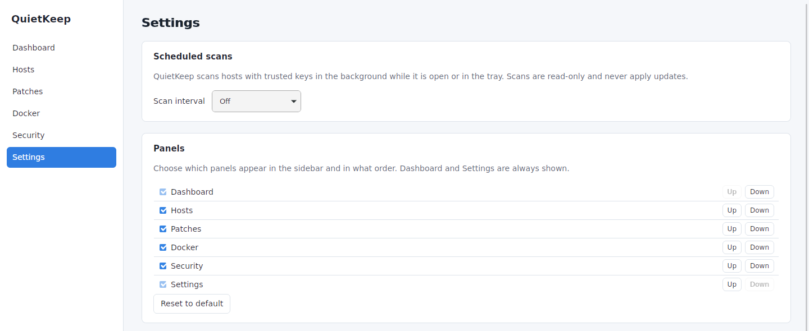
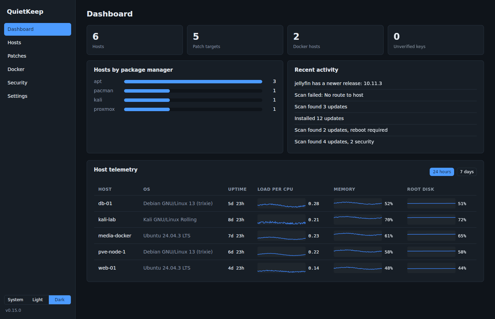

# QuietKeep

Standalone desktop app for Debian 13 and Ubuntu that keeps a small to medium homelab patched and monitored. It runs entirely on the local machine with no external server.

## Status

**Alpha: work in progress.** No packages yet. Features and screens will change. Build from source to try it.

The current version is 0.15.0. QuietKeep is agentless and uses SSH. An optional host agent is planned. Version 1.0.0 will be the first release with packages.

## Features

- Host list with CSV import and export in the original QuietKeep format
- SSH host key pinning with explicit approval and an app owned ed25519 key
- One click Set up access for a single host or all hosts, using your own SSH key through ssh-agent
- Read only patch scans for apt, Kali, Proxmox and pacman hosts
- Held back apt updates (phased by Ubuntu or kept back) shown apart from installable ones
- Host telemetry charts for load, memory, root disk and uptime
- Confirmed patching and rebooting through an exact command sudoers rule
- Docker inventory with release tracking, pin moves, `.env` tag updates, moving `docker run` containers to compose and confirmed compose updates
- CISA KEV catalog with offline search, downloaded only after you allow it
- Fixed version checks from OSV for Debian, Ubuntu, Kali, Parrot and Proxmox hosts
- Scheduled background scans from the tray, off by default
- Panels you can hide and reorder
- System, light and dark themes

## Screenshots

Work in progress: screens will change before 1.0.0. The hosts and addresses below are made up examples.

**Dashboard:** host counts, recent activity and 24 hour telemetry for every trusted host.



**Hosts:** pinned host keys, Set up access and CSV import and export.



**Patches:** pending and security updates, reboot state and confirmed patching.



**Docker:** containers by compose project with release tracking.



**Settings:** scheduled scans and panels you can hide and reorder.



**Dark mode:** system, light or dark.



## Security model

- QuietKeep opens no listening port. It only connects out to hosts you add.
- It never trusts a host key on its own. You approve each fingerprint, and a changed key blocks the connection.
- It uses its own SSH key for all normal work. Set up access logs in once with your own key through ssh-agent and installs QuietKeep's key. Your private keys never leave the agent.
- QuietKeep's private key is encrypted, and its passphrase is kept in the desktop keyring (GNOME Keyring or KWallet).
- Scans never use sudo. Patching and rebooting run only the commands listed in `/etc/sudoers.d/quietkeep`. Set up access can install that rule with a sudo password you type once. QuietKeep never stores passwords.
- Every patch, reboot, container update and download asks for confirmation first. Registry checks for Docker images run only after you allow them.

## Data

All data lives in `~/.local/share/dev.quietwire.quietkeep` with owner only permissions:

| File | Contents |
|---|---|
| `quietkeep.db` | Hosts, scan results, settings and activity log (SQLite) |
| `identity_ed25519` | QuietKeep's private SSH key |
| `cisa_kev.json` | Cached CISA KEV catalog |

Delete this folder to remove all QuietKeep data.

## Build from source

Requirements: Rust stable, the `wasm32-unknown-unknown` target, `trunk`, `tauri-cli` 2 and the Tauri Linux dependencies (WebKitGTK 4.1, GTK 3, Ayatana AppIndicator, librsvg).

```sh
cargo test --workspace --exclude qk-ui
cd crates/quietkeep && cargo tauri dev
```

`cargo tauri build` also makes a `.deb` in `target/release/bundle/deb/`. It is for your own testing only while QuietKeep is in alpha.

See `CONTRIBUTING.md` for the project rules.

## Layout

| Crate | Purpose |
|---|---|
| `qk-core` | Shared domain types, validation, CSV and update parsers |
| `qk-store` | Local SQLite storage and migrations |
| `qk-ssh` | SSH transport with host key pinning |
| `qk-collect` | Package and Docker collectors, patch and reboot actions |
| `qk-intel` | CISA KEV catalog, OSV fixed versions and host matching |
| `qk-jobs` | Job runner (planned) |
| `qk-auth` | Desktop keyring storage for the SSH key passphrase |
| `quietkeep` | Tauri 2 desktop shell, tray and scheduler |
| `qk-ui` | Rust/WebAssembly user interface (Leptos) |

## License

Copyright (C) 2026 Dennis Ayotte

QuietKeep is free software: you can redistribute it and/or modify it under the terms of the GNU General Public License as published by the Free Software Foundation, either version 3 of the License or (at your option) any later version. See [LICENSE](LICENSE).
